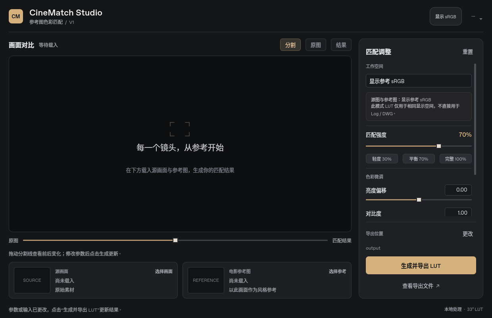

# CineMatch Studio · v0.4.0 实验版

[**点击下载 Mac 安装包（新版调色界面）**](https://github.com/Huajuan001/Alex/raw/refs/tags/v0.4.0/CineMatchStudio-v0.4.0-Monterey.zip)

## 使用

1. 完整解压 ZIP，双击 **“显示安装进度.command”**。它会自动安装并显示进度，无需输入命令。也可打开“安装 CineMatch Studio.app”，它会先固定资源，再打开进度窗口。
2. 保持进度窗口打开，等待“安装成功”或具体错误；成功后重开 Resolve。
3. 从“工作区 → 脚本 → CineMatch Studio”启动；可能分组在 Utility。
4. 选择 sRGB 或 DWG/Intermediate 模式。包内“DWG 示例”可先试跑。

macOS 12 Monterey 及以上，Intel / Apple Silicon。开发版尚未签名/公证，首次打开如被系统阻止，使用 macOS 提供的右键“打开”选项。无需关闭安全保护。

## v0.4.0 界面更新

深灰工作区、大幅画面对比、并排素材卡片和右侧参数栏。支持拖动分割线、原图/分割/结果切换、强度预设、数值与滑杆同步及重置。选图即预览，较小窗口的导出按钮保持可见。

截图来自 Linux Qt 离屏运行；macOS 字体与窗口装饰以本机为准。匹配算法和依赖锁文件不变，升级复用已有 Python 与依赖。用户已确认上一版在 Monterey / Resolve 19.1 可用，新界面待本机查看。升级前先退出旧调色窗口，再运行新包的安装入口。

## 延续 v0.3.2 安装修复

针对在组装应用时出现的 `AppTranslocation/.../macos/launch-app.sh` 缺失错误：先将完整安装资源复制并校验到用户 Application Support 中，再进行耗时安装。之后临时源目录消失也不再影响组装。

依赖锁文件不变，会复用原先下载的 Python 与依赖。安装过程显示下载、pip 和阶段输出；错误记录阶段与退出码。另附“查看安装诊断.command”，只生成诊断报告，不重装、删锁或停止任务。

v0.3.1 的 macOS 12 最低版本修复保持不变。本工具的兼容范围不改变 Resolve 自身的系统/GPU要求；当前本机对接目标为 Resolve 19.1，未调用 21 专属 API。

## 工作空间

- sRGB：普通显示参考图片；sRGB→sRGB LUT，不可直接套到 Log / DWG。
- DWG：真正编码为 DWG/Intermediate 的全范围 RGB16/浮点 TIFF；参考图为 sRGB。调色 LUT 为 DWG→DWG 33³，放在输出变换之前。编码域限 0..1。
- 相机原生 Log 先正确转换到 DWG；已经由工程色彩管理转换时不要重复 CST。
- `View` LUT 是诊断显示变换，用于复现预览，不与另一套输出显示变换叠加。预览与 Resolve DRT 不同。
- 当前帧导出和节点加载仍为手动流程；全局统计原型，没有语义肤色保护、局部遮罩或跟踪。

## 验证与反馈

Linux CPython 3.11 完整测试 **128 项通过**，含临时源目录删除后的组装回归、进度入口、退出码、安装升级和原有色彩/界面测试。ShellCheck 通过。用户已确认上一版 macOS 安装启动可用；新版界面和 Resolve 输出一致性仍待实机验证。

完整源码和文档在安装器包 `Contents/Resources/project` 中。日志位于 `~/Library/Logs/CineMatchStudio/`。新进度窗口会显示具体错误，可提供日志末尾继续排查。

同目录 `.sha256` 文件提供安装包校验值。先前下载的旧包不会自动更新，请使用本次新解压的文件夹。
